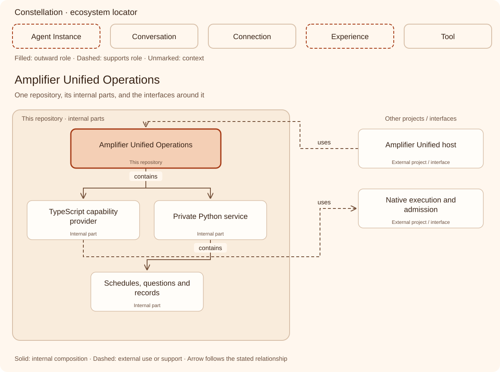

# Unified operations capability

Add persistent schedules, questions, observation watches and operation tracking
to an Amplifier Unified host. A TypeScript provider connects the host to a private
Python service that stores requests and results. The host and native runtime
continue to own execution and admission.

This is an integration package for host developers, not a standalone chat client.

## Get started

Use Node.js, Python 3.11+ and uv. From a checkout:

```sh
uv sync --directory python --no-dev
npm ci
npm run build
```

Install the checkout into your host project with
`npm install /absolute/path/to/amplifier-unified-capability-operations`.
Create a private `operations.json` with a directory dedicated to this installation:

```json
{"dataDir": "/absolute/private/operations"}
```

Compose the provider with your host callbacks and the installed Python command:

```js
import {createOperationsCapabilities} from '@amplifier/unified-operations-capabilities';

const provider = createOperationsCapabilities({
  ...ownerContext,
  owner: {
    command: '/absolute/venv/bin/amplifier-unified-operations',
    args: ['--config', '/absolute/operations.json'],
  },
});
await provider.start();
// Register the provider with your host; call await provider.close() at shutdown.
```

Use the executable from the environment prepared above (`Scripts` on Windows).
`ownerContext` is your integration, supplying the required callbacks in
[`Options`](src/index.ts): session inspection/context, native control, session
creation, scheduled submission and waiting for a turn. Do not replace these with
callbacks that merely report success.

## Integration requirements

- Wire the matching question, observation and operation-event callbacks before
  advertising those features. Optional integrations are not enabled by configuration alone.
- Pass authenticated session and actor context; request arguments cannot grant authority.
- Keep private service data separate from native session history. An accepted
  request is not necessarily completed work.
- Preserve unknown outcomes after transport loss. Reusing a request ID returns
  its original receipt; it must not replay work with changed arguments.

The exported [TypeScript interfaces and action names](src/index.ts) describe the
host boundary. [Service lifecycle](src/service-lifecycle.ts) and
[retention integration](src/retention.ts) are for distribution owners implementing
updates or recovery. Contributor instructions are in [AGENTS.md](AGENTS.md).


<!-- ecosystem-map:start -->
## Where this fits

Optional schedules, questions, watches and operation records behind a Unified host capability.

Supports: Agent Instance, Experience.



[Open the map](docs/ecosystem-map.svg) · [Product page source (private)](docs/product/index.html) · [Map guide](https://github.com/microsoft/amplifier-constellation/blob/main/docs/ecosystem-maps.md)

<details>
<summary>The five shared building blocks</summary>

[](https://microsoft.github.io/amplifier-constellation/)

</details>

<!-- ecosystem-map:end -->

## Contributing

Most contributions require you to agree to a
Contributor License Agreement (CLA) declaring that you have the right to, and actually do, grant us
the rights to use your contribution. For details, visit [Contributor License Agreements](https://cla.opensource.microsoft.com).

When you submit a pull request, a CLA bot will automatically determine whether you need to provide
a CLA and decorate the PR appropriately (e.g., status check, comment). Simply follow the instructions
provided by the bot. You will only need to do this once across all repos using our CLA.

This project has adopted the [Microsoft Open Source Code of Conduct](https://opensource.microsoft.com/codeofconduct/).
For more information see the [Code of Conduct FAQ](https://opensource.microsoft.com/codeofconduct/faq/) or
contact [opencode@microsoft.com](mailto:opencode@microsoft.com) with any additional questions or comments.

## Trademarks

This project may contain trademarks or logos for projects, products, or services. Authorized use of Microsoft
trademarks or logos is subject to and must follow
[Microsoft's Trademark & Brand Guidelines](https://www.microsoft.com/legal/intellectualproperty/trademarks/usage/general).
Use of Microsoft trademarks or logos in modified versions of this project must not cause confusion or imply Microsoft sponsorship.
Any use of third-party trademarks or logos are subject to those third-party's policies.
